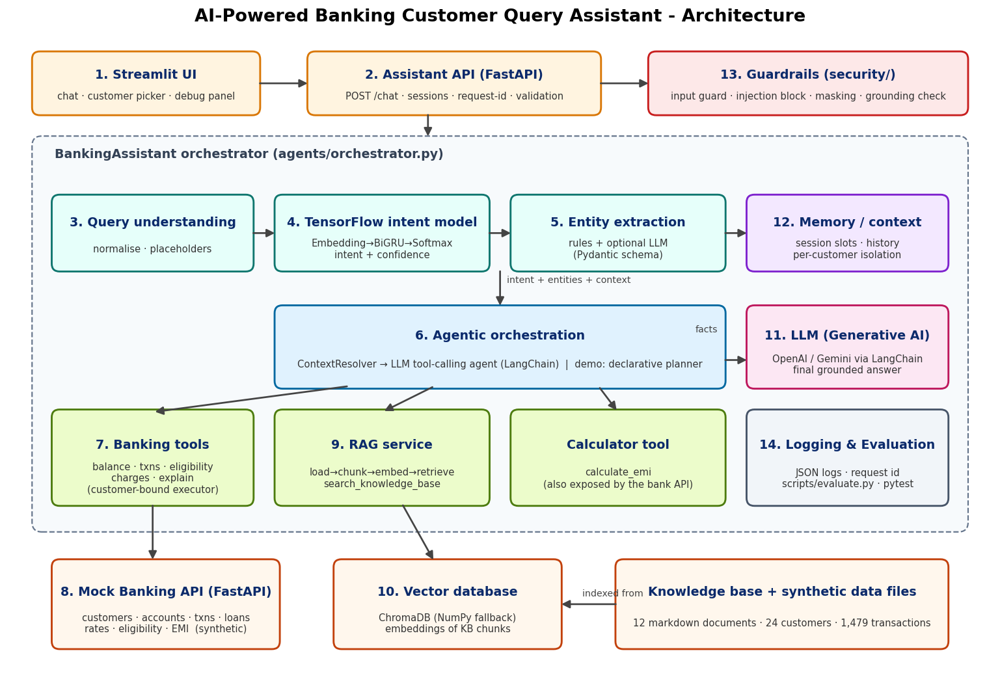

# AI-Powered Banking Customer Query Assistant

A production-style **AI/ML + Generative AI + Agentic AI** assistant that answers natural-language banking questions
(balance, transactions, loans, EMI, charges, policies) using **TensorFlow intent classification, NLP entity extraction,
LangChain tool-calling agents, RAG over a ChromaDB vector store, conversation memory and a FastAPI mock core-banking backend**.
**All data is synthetic** - no real customers, accounts, credentials or banking systems are used anywhere.

> **Honest status:** see [Validation status](#validation-status). The TensorFlow, FastAPI, LangChain/Chroma and real-LLM code paths
> could not be executed in the (offline) environment where this project was generated; the rest was executed and tested.

## 1-2. Problem statement and objectives

Customers contact banks for repetitive queries. Answering them needs (a) *understanding* free-form language, (b) *fetching the right
customer data safely*, (c) *grounding* general answers in bank policy, and (d) *never inventing* financial facts.
Targets from the problem statement: **>= 80% query-resolution accuracy** and **< 15 s response time**.

Objectives: understand 16 intents and 10+ entity types; route each query to the correct source (customer data / product catalogue /
knowledge base / calculator / safe fallback); support multi-turn context; enforce privacy and anti-hallucination guardrails; measure everything.

## 3. Solution overview

```
User -> Streamlit -> FastAPI /chat -> guard -> memory -> TensorFlow intent -> entities -> context resolver
     -> agent (LLM tool-calling | demo planner) -> tools (mock bank API | RAG | calculator)
     -> grounded response (LLM or template) -> grounding check -> memory update -> JSON log
```

| Question type | Source | Example |
|---|---|---|
| Customer-specific | Mock Banking API (tools) | "What is my balance?" |
| Product catalogue / rates | Mock Banking API | "Interest rate for a personal loan?" |
| General policy | RAG knowledge base | "Minimum balance for a savings account?" |
| Calculation | Calculator tool | "EMI for 5 lakh, 5 years, 10%" |
| Unknown / out of scope | Safe fallback | "Tell me a joke" |

## 4-5. Architecture and diagram



| # | Layer | Code |
|---|---|---|
| 1 | User interface | `frontend/streamlit_app.py` |
| 2 | API / backend | `banking_ai/api/assistant_app.py` |
| 3 | Query understanding | `banking_ai/nlp/preprocessing.py` |
| 4 | ML intent classification | `banking_ai/ml/` (TensorFlow) |
| 5 | Entity extraction | `banking_ai/nlp/entities.py` |
| 6 | Agentic orchestration | `banking_ai/agents/` |
| 7 | Banking tools | `banking_ai/tools/` |
| 8 | Mock banking APIs | `banking_ai/api/bank_app.py`, `banking_ai/bank/` |
| 9 | RAG knowledge base | `knowledge_base/`, `banking_ai/rag/` |
| 10 | Vector database | ChromaDB (NumPy fallback) in `banking_ai/rag/vector_store.py` |
| 11 | LLM / GenAI | `banking_ai/llm/` |
| 12 | Memory / context | `banking_ai/memory/`, `banking_ai/agents/context.py` |
| 13 | Validation / guardrails | `banking_ai/security/` |
| 14 | Evaluation / monitoring | `banking_ai/evaluation/`, `scripts/evaluate.py`, `banking_ai/config/logging_config.py` |

Key design decision - **hybrid understanding**: the TensorFlow model gives a fast, cheap, offline *intent + confidence*; deterministic
rules extract exact values (amounts, tenures); the LLM (when configured) is used where language flexibility is needed - choosing tools,
writing the final answer, and (optionally) filling entity gaps. Low-confidence queries are not guessed: with an LLM the agent decides
freely, without one the user is asked to clarify.

## 6. Technology stack

Python 3.10-3.12 · TensorFlow/Keras · scikit-learn · NumPy/Pandas · Pydantic v2 · LangChain (`langchain-core`, `langchain-openai`,
`langchain-google-genai`, `langchain-chroma`) · ChromaDB · FastAPI + Uvicorn · Streamlit · Requests · pytest · Docker.
Every technology has a concrete job (see the PDF guide); nothing is included for decoration.

## 7. Folder structure

```
banking_ai_assistant/
├── banking_ai/
│   ├── config/        settings (env) + structured logging
│   ├── security/      masking, input guard, grounding validator
│   ├── bank/          synthetic bank domain: service, calculators, clients (HTTP / in-process)
│   ├── api/           bank_app.py (mock core banking), assistant_app.py (chat API), schemas
│   ├── ml/            tokenizer, dataset, Keras model, training, inference, sklearn baseline
│   ├── nlp/           preprocessing + entity extraction (rules + optional LLM)
│   ├── rag/           documents/chunking, embeddings, vector stores, RagService
│   ├── tools/         tool schemas, toolkit + executor, LangChain adapter
│   ├── memory/        session store (isolation, TTL)
│   ├── llm/           provider factory, prompt loader, chains, deterministic templates
│   ├── agents/        orchestrator, context resolver, planner, LangChain tool agent
│   ├── evaluation/    metric helpers
│   ├── datagen/       synthetic data generators (bank, intents, evaluation sets)
│   └── prompts/       *.txt prompt templates (kept out of Python code)
├── knowledge_base/    12 markdown policy/product documents (RAG source)
├── data/              bank/*.json, ml/intent_dataset.csv, evaluation/*.json
├── models/            intent/ (TF model after training), vector_store/ (index)
├── frontend/          streamlit_app.py
├── scripts/           generate_data, train_intent_model, build_vector_store, evaluate, run_demo
├── tests/             pytest suite
├── docs/              architecture.png, SAMPLE_CONVERSATIONS.md
├── evaluation_reports/ measured reports
├── Dockerfile · docker-compose.yml · requirements.txt · .env.example · pytest.ini
```

## 8. Data flow

1. UI posts `{customer_id, message, session_id}` to `POST /chat`.
2. `InputGuard` cleans the text, blocks prompt-injection and other-customer references.
3. `SessionStore` returns the caller's session (a session id owned by another customer -> HTTP 403).
4. `IntentClassifier` (TensorFlow) -> `intent`, `confidence`.
5. `HybridEntityExtractor` -> Pydantic `ExtractedEntities`.
6. `ContextResolver` merges session slots / resolves follow-ups ("I need 5 lakh", "what about 10 years?").
7. Tools are chosen (LLM tool-calling, or the declarative planner in demo mode) and executed by a `ToolExecutor` bound to the session's customer.
8. Response: LLM writes from verified facts -> `GroundingValidator` -> else deterministic template answer.
9. Memory updated, structured log written, JSON returned (plus optional debug summary).

## 9. TensorFlow model

`Input(24 token ids) -> Embedding(64, mask_zero) -> Bidirectional(GRU 48) -> Dropout -> Dense(64, ReLU) -> Dropout -> Dense(16, softmax)`.
Word order matters in queries ("compare X and Y" vs "calculate EMI for Y"), so a sequence model beats bag-of-words in principle; a
bidirectional GRU is small, fast on CPU and trains well on ~2k short sentences. Pipeline: synthetic dataset -> normalise (numbers become
`<num>` placeholders) -> `Vocabulary` (tokenise, ids, pad) -> stratified 70/15/15 split (vocab fit on train only) -> class-weighted training with early stopping ->
test metrics -> saved `.keras` model + `vocab.json` + `labels.json` + `metrics.json`. Confidence = max softmax probability.
Held-out metrics from synthetic data are optimistic; trust `scripts/evaluate.py` (hand-written queries) instead.

## 10. NLP pipeline

Normalisation (NFKC, lowercase, number words -> digits) -> intent classification -> entity extraction. Rules handle `lakh/crore/k`, `5 years -> 60 months`,
percentages, dates, ids, counts, loan/account types, channels and salary-vs-loan-amount disambiguation. Only the **last 4 digits** of account numbers are ever kept.
When an LLM is configured and `USE_LLM_ENTITY_EXTRACTION=true`, `with_structured_output(ExtractedEntities)` fills slots the rules missed.

## 11. LangChain

Used for: chat models (`ChatOpenAI`, `ChatGoogleGenerativeAI`), `ChatPromptTemplate`/`MessagesPlaceholder` + LCEL (`prompt | model | parser`) for answers,
`with_structured_output` for entities, `StructuredTool` + `bind_tools` for tool calling, `Embeddings` interface and `Chroma` vector store for RAG.
Agent loop (`agents/langchain_agent.py`): the LLM receives the question + NLU hints, returns tool calls, tools run via the executor, results return as `ToolMessage`s, up to `LLM_MAX_TOOL_STEPS`.
LangGraph is intentionally *not* used: the flow is a short bounded loop and an explicit loop is easier to read and test.

## 12. Agentic AI

The agent chooses *which* tools to call (possibly several), observes results and decides what to do next. Tools: `get_account_balance`, `get_account_details`,
`get_transaction_history`, `get_recent_transaction`, `get_loan_products`, `check_loan_eligibility`, `get_interest_rates`, `calculate_emi`, `get_account_charges`,
`explain_transaction`, plus `compare_loan_products` and `search_knowledge_base` (RAG). Tools have **no customer_id parameter**: the authenticated customer is injected by the system.
**Demo mode (no API key)** uses a declarative planner (`agents/planner.py`) that applies the same routing policy as a table - deterministic, testable, and clearly labelled as *not* an LLM.

## 13-14. RAG and vector database

`knowledge_base/*.md` -> loader -> heading-aware chunker (chunk size/overlap configurable) -> embeddings -> ChromaDB (cosine) -> retriever (top-k, minimum-similarity threshold) -> context -> LLM answer
(or extractive lines in demo mode). The index fingerprint (content + parameters) triggers automatic rebuilds. Default embeddings are offline **TF-IDF** (lexical); for semantic retrieval set
`EMBEDDING_PROVIDER=huggingface` (`pip install langchain-huggingface sentence-transformers`). If nothing clears the threshold the assistant says it has no information.

## 15. Mock banking APIs

FastAPI service on port 8001 (`/docs`): `GET /api/customers/{id}`, `/api/accounts/{id}`, `/api/accounts/{id}/balance`, `/api/accounts/{id}/transactions`, `/api/accounts/{id}/charges`,
`/api/accounts/{id}/deductions/explain`, `/api/transactions/{txn_id}?customer_id=`, `/api/loans`, `/api/loans/{type}`, `/api/interest-rates`, `POST /api/loans/eligibility`, `POST /api/emi/calculate`.
Deviation from the sketch in the brief: `/api/transactions/{id}` requires `customer_id` (ownership check), and `/deductions/explain` was added for "why was money deducted?". Optional `X-API-Key`.

## 16. LLM

`LLM_PROVIDER=mock|openai|gemini`, `LLM_MODEL`, `LLM_API_KEY`, optional `LLM_BASE_URL` (OpenAI-compatible endpoints). Without a key the system runs in **demo mode**: TensorFlow intents, entity extraction, tools, RAG, memory,
guardrails and template answers all work; only LLM tool selection and LLM-written phrasing are absent. **Requires an API key:** LLM tool-calling, LLM answer generation, LLM entity extraction, OpenAI embeddings.

## 17. Memory

`SessionStore` keeps recent turns and *slots* (loan type/amount/tenure/rate/income) per session. Sessions are bound to one customer; presenting a session id from another customer raises `SessionOwnershipError` (HTTP 403).
Server-generated ids only; TTL expiry; history capped. Loan slots are cleared when the topic changes.

## 18. Security

Environment-based config, no hardcoded keys; input validation and length limits; prompt-injection and cross-customer detection; masking of account numbers/e-mails/phones (API + logs); logs never contain message text or full account numbers
(customer ids are hashed); tools cannot choose the customer; **grounding validator** rejects LLM answers containing money/percent figures absent from tool/KB facts (falls back to template); safe error messages; API-key protected bank API.
Not production-ready: no real authentication, rate limiting, TLS or persistent audit store (see Future improvements).

## 19. Evaluation

`python scripts/evaluate.py` runs 65 single-turn queries + 3 multi-turn conversations + 24 RAG queries (+5 negatives) and reports intent accuracy/confidence, entity accuracy (field and exact), tool-selection accuracy,
RAG hit@1/hit@3/MRR/negative-rejection, end-to-end resolution accuracy and latency (mean/p50/p95/max) against the 80% / 15 s targets. Exit code is non-zero if a target is missed. Reports are written to `evaluation_reports/latest.json`.

**Measured in the generation sandbox (demo mode, scikit-learn fallback classifier, NumPy vector store, in-process bank - NOT the TensorFlow model):** intent accuracy 98.6%, entity accuracy 100%, tool selection 98.6%,
RAG hit@3 100% / hit@1 87.5%, end-to-end resolution 97.3% (2 honest misses: "can I get a mini statement" -> loan intent; a "what happens if I don't maintain..." answer that missed the penalty line), p95 latency 2 ms.
See `evaluation_reports/sandbox_run_sklearn_demo_mode.json`. **Re-run the script after training TensorFlow** to get your own numbers; LLM-mode latency will be dominated by the LLM API (typically 2-8 s).

## 20. Testing

```bash
pytest                       # all tests
pytest tests/test_tensorflow_model.py -v
pytest -k "end_to_end or memory"
```
Covers: TensorFlow model (build/train/save/load/predict), intent prediction, entities, bank service + API (auth, validation, ownership), tools (including "LLM-supplied customer id is ignored"), RAG, planner/agent tool selection
(with a scripted fake chat model for the LangChain loop), EMI maths, memory isolation, security, evaluation metrics and end-to-end flows. Modules needing TensorFlow/FastAPI/LangChain skip themselves when those are not installed.

## 21-23. Installation, configuration, running

```bash
unzip AI_Banking_Customer_Query_Assistant.zip && cd banking_ai_assistant
python -m venv .venv && source .venv/bin/activate          # Windows: .venv\Scripts\activate
pip install -r requirements.txt
cp .env.example .env                                        # edit if you have an LLM key
python scripts/generate_data.py                             # optional: data is already included (regenerates deterministically)
python scripts/train_intent_model.py                        # trains + saves the TensorFlow model to models/intent/
python scripts/build_vector_store.py                        # builds the ChromaDB index (also auto-built on first start)

uvicorn banking_ai.api.bank_app:app --port 8001             # terminal 1: mock core banking
uvicorn banking_ai.api.assistant_app:app --port 8000        # terminal 2: assistant API
streamlit run frontend/streamlit_app.py                     # terminal 3: UI at http://localhost:8501

pytest                                                       # tests
python scripts/evaluate.py                                   # evaluation (set BANK_API_MODE=inprocess or use --bank-mode inprocess)
python scripts/run_demo.py                                   # regenerate docs/SAMPLE_CONVERSATIONS.md
```
No second server wanted? Set `BANK_API_MODE=inprocess` in `.env`. Docker: `docker compose up --build` (UI :8501, assistant :8000, bank :8001).
To enable the LLM: `LLM_PROVIDER=openai`, `LLM_MODEL=gpt-4o-mini`, `LLM_API_KEY=...` (or `gemini` + a Gemini model/key).

## 24-25. API documentation and examples

Interactive docs: `http://localhost:8000/docs` (assistant) and `http://localhost:8001/docs` (bank).

```bash
curl -s localhost:8000/chat -H 'Content-Type: application/json' \
  -d '{"customer_id":"CUST1001","message":"Can I get a personal loan of 5 lakh for 5 years?","debug":true}'
```
`POST /chat` -> `{session_id, request_id, response, status, latency_ms, debug{intent, confidence, entities, tools, rag_documents, ...}}`; pass the returned `session_id` for follow-ups.
`DELETE /sessions/{id}?customer_id=` clears a conversation. `GET /health`. `GET /demo/customers` (demo mode only).

Example queries: *What is my account balance? · Show my last 5 transactions · What was my last transaction? · Can I get a personal loan of 5 lakh for 5 years? · What is the interest rate for a personal loan? ·
Calculate EMI for 5 lakh for 5 years at 10% · What are the charges for my account? · What is the minimum balance for a savings account? · Compare personal loan and home loan · Why was money deducted from my account? (try CUST1002) ·
I want a personal loan → I need 5 lakh → what about 7 years?* Full outputs: `docs/SAMPLE_CONVERSATIONS.md`. Demo customers: `CUST1001`-`CUST1024` (CUST1003 is intentionally ineligible for loans).

## 26. Troubleshooting

| Symptom | Fix |
|---|---|
| "TensorFlow intent model unavailable ... falling back" | Run `python scripts/train_intent_model.py` (or install tensorflow). |
| UI says it cannot reach the API | Start `uvicorn banking_ai.api.assistant_app:app --port 8000`; check `ASSISTANT_API_URL`. |
| Assistant answers "unable to retrieve" | Bank API not running on `BANK_API_URL`, or `BANK_API_KEY` differs between services. Use `BANK_API_MODE=inprocess` to test. |
| "Missing data/bank/..." | `python scripts/generate_data.py` |
| `chromadb` import errors | `pip install chromadb langchain-chroma`, or set `VECTOR_BACKEND=numpy`. |
| "this month" returns nothing | The bank's date is the latest transaction date; regenerate data (`--anchor YYYY-MM-DD`) or set `BANK_AS_OF_DATE`. |
| LLM mode silently behaves like demo mode | Both `LLM_PROVIDER` (not `mock`) **and** `LLM_API_KEY` must be set; check logs for provider import errors. |

## 27. Future improvements

Real authentication (OAuth/JWT) instead of the demo customer picker; Redis session store; rate limiting and audit trail; semantic embeddings by default and a reranker; fine-tuned/transformer intent model and calibrated confidence;
human-handoff flow; multilingual (Hindi) support; streaming responses; OpenTelemetry/MLflow monitoring; LangGraph if flows grow branching; adversarial/red-team evaluation suite; larger, human-labelled evaluation set.

## Validation status

| Area | Status in generation sandbox (offline) |
|---|---|
| Python syntax / imports of all modules | **Verified** (`ast` parse of every file; core modules imported and run) |
| Synthetic data generation, bank service, EMI, eligibility | **Executed and tested** |
| NLP preprocessing, entity extraction, tokenizer, dataset | **Executed and tested** |
| RAG chunking, TF-IDF embeddings, NumPy vector store, retrieval | **Executed and tested** |
| Memory, security, guardrails, planner, templates, orchestrator, evaluation | **Executed and tested** (129 tests passed with a minimal pytest-compatible runner; `pydantic` was replaced by a small stand-in in the sandbox) |
| TensorFlow model training/inference | **Written, NOT executed** (TensorFlow could not be installed offline) - sklearn fallback was used for all measured numbers |
| FastAPI apps, Streamlit UI | **Written, NOT executed** (packages unavailable); route logic is the tested service layer |
| LangChain agent/chains, ChromaDB store | **Written, NOT executed**; the agent loop has a test with a fake chat model that runs once `langchain-core` is installed |
| Real LLM (OpenAI/Gemini) | **Not tested** - no API key / network |
| Docker build | **Not tested** |

First thing to do after install: `pytest` and `python scripts/evaluate.py`. If something in the untested layers needs a small fix (e.g. a library version difference), the tests will point to it.
